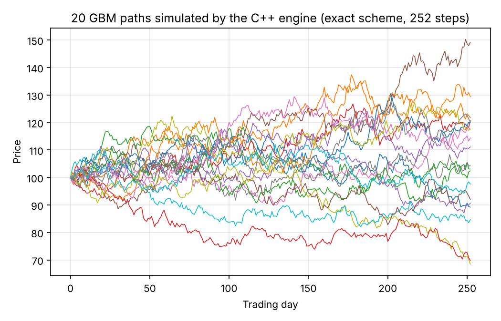
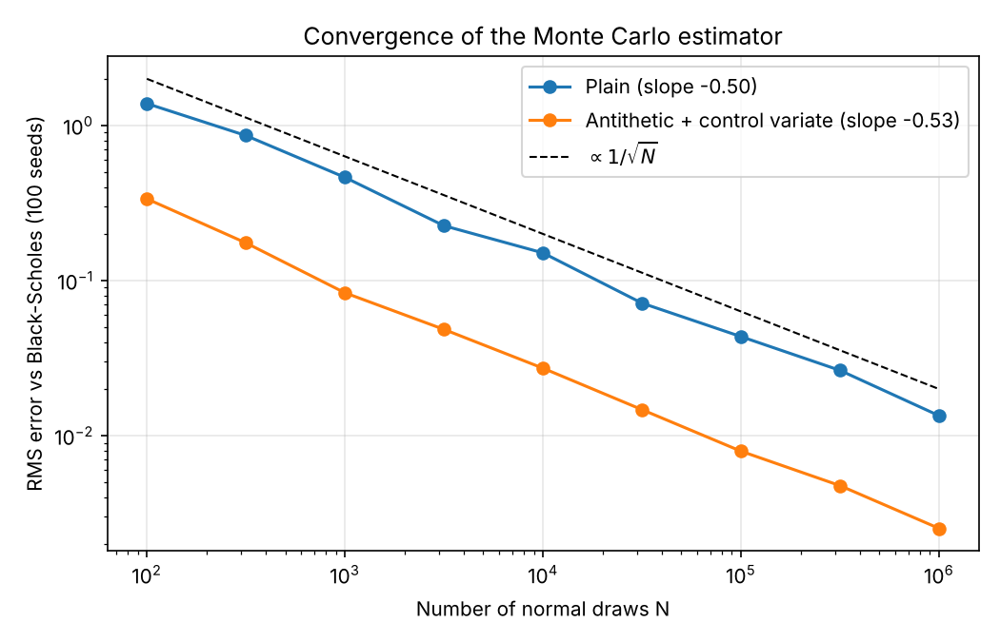
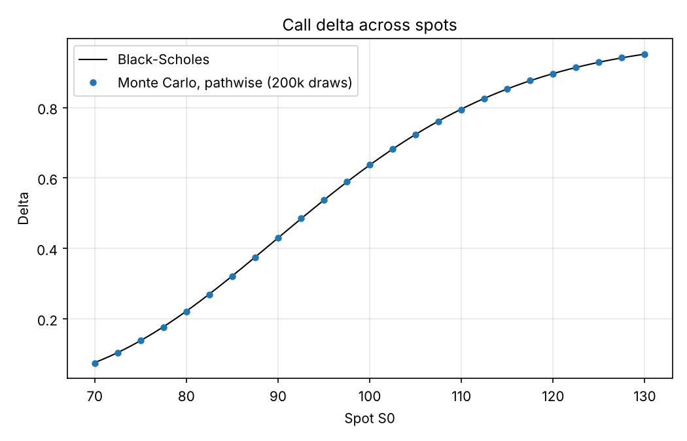
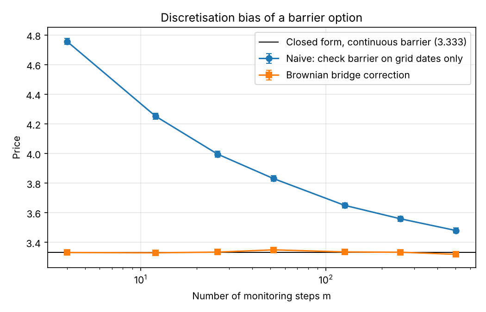

# Monte Carlo Derivatives Pricer (C++ / Python)

A multithreaded Monte Carlo engine in C++17, driven from Python through `ctypes`, that prices
European, Asian and barrier options and their Greeks. **Every result is checked against a
closed-form solution**, and every number below is reproduced by one command (`make experiments`).

| | Result |
|---|---|
| Validation | European price inside the 95% CI of Black-Scholes; CI coverage 94.8% over 1,000 seeds; error decays as N^(-1/2) (measured slope -0.505) |
| Variance reduction | Antithetic + control variate: **x29 lower variance** on a European call; geometric control variate: **x1,300** on an arithmetic Asian |
| Greeks | Delta, Gamma, Vega (finite differences with common random numbers, and pathwise) all within 1.3 standard errors of Black-Scholes |
| Barrier options | Brownian-bridge correction removes the discretisation bias: 3.331 with 4 time steps vs 3.333 exact, where naive monitoring gives 4.757 |
| Performance | 10M paths in 34 ms on 4 cores, x4.7 faster than vectorised NumPy; identical results for any thread count and machine |

## 1. Model

Under the risk-neutral measure the underlying follows a geometric Brownian motion,

$$dS_t = r S_t\,dt + \sigma S_t\,dW_t,$$

whose solution is known exactly. Paths are therefore simulated with the **exact scheme** (no
Euler discretisation error):

$$S_{t+\Delta t} = S_t \exp\left(\left(r - \tfrac{\sigma^2}{2}\right)\Delta t + \sigma\sqrt{\Delta t}\,Z\right), \qquad Z \sim \mathcal N(0,1).$$

A European payoff depends only on $S_T$, so it is simulated in **one step** with O(1) memory.
The price $C_0 = e^{-rT}\,\mathbb E[(S_T-K)^+]$ is estimated by the sample mean $\hat C_N$, with
standard error $\hat s/\sqrt N$ and 95% confidence interval $\hat C_N \pm 1.96\,\hat s/\sqrt N$
(central limit theorem).



## 2. Validation and convergence

The RMS error against Black-Scholes, averaged over 100 seeds, follows the $N^{-1/2}$ rate. Variance
reduction shifts the line down without changing the slope: it improves the constant, not the rate.



## 3. Variance reduction

- **Antithetic variates**: each draw $Z$ is paired with $-Z$. The call payoff is monotone in $Z$, so
  the two payoffs are negatively correlated and their average has lower variance.
- **Control variate**: $X = e^{-rT}S_T$ has known mean $S_0$ (discounted price is a martingale).
  The estimator $\bar Y - \beta(\bar X - S_0)$ with $\beta = \mathrm{Cov}(Y,X)/\mathrm{Var}(X)$ cuts the
  variance by a factor $1/(1-\rho^2)$.

| Estimator (1M normal draws) | Std error | Variance reduction | Efficiency gain (variance x run time) |
|---|---|---|---|
| Plain | 0.0147 | x1.0 | x1.0 |
| Antithetic | 0.0104 | x2.0 | x2.7 |
| Control variate | 0.0056 | x6.9 | x6.9 |
| Antithetic + control variate | 0.0027 | **x28.7** | **x39.0** |

## 4. Greeks

All Greeks are computed from the **same** random draws (common random numbers), which keeps the
finite-difference estimators stable. The pathwise method differentiates the payoff inside the
expectation: $\Delta = e^{-rT}\,\mathbb E[\mathbf 1_{S_T>K}\,S_T/S_0]$.

| Greek | Monte Carlo (1M draws) | Black-Scholes | Gap (std errors) |
|---|---|---|---|
| Delta, finite difference | 0.63642 ± 0.00057 | 0.63683 | -0.7 |
| Delta, pathwise | 0.63655 ± 0.00058 | 0.63683 | -0.5 |
| Gamma, finite difference | 0.01880 ± 0.00011 | 0.01876 | +0.4 |
| Vega, finite difference | 37.427 ± 0.076 | 37.524 | -1.3 |
| Vega, pathwise | 37.428 ± 0.076 | 37.524 | -1.3 |



## 5. Path-dependent options

**Arithmetic Asian call** (12 monthly fixings). There is no closed form, but the *geometric* Asian
call has one, since the log of a geometric average of log-normals is Gaussian. Its payoff is 99.96%
correlated with the arithmetic one, which makes it an excellent control variate:

| Estimator (200k paths) | Price | Std error |
|---|---|---|
| Plain Monte Carlo | 6.1466 | 0.0190 |
| Geometric Asian control variate | 6.1561 | 0.00052 |

That is a **x1,314 variance reduction**: the same accuracy as 260 million plain paths.

**Up-and-out call** (continuous barrier B = 130). Checking the barrier only at grid dates misses
crossings between dates, so the naive estimator overprices, and the bias decays slowly. Conditional
on two consecutive log-prices $x_i, x_{i+1}$ below $b=\log B$, the probability that the Brownian
path crossed $b$ in between is $\exp\left(-2(b-x_i)(b-x_{i+1})/(\sigma^2\Delta t)\right)$. Weighting the
payoff by the survival probability removes the bias, even on a coarse grid:



## 6. Engineering

- **Parallelism**: paths are split into blocks of 16,384, distributed over `std::thread` workers.
  Each block has its own `std::mt19937_64` stream seeded from (seed, block index), so results are
  reproducible and **bit-for-bit identical whatever the number of threads** (tested).
- **Normal generator**: a 128-layer Ziggurat (Marsaglia & Tsang), 4.4x faster than
  `std::normal_distribution`. Its output passes moment, tail and Kolmogorov-Smirnov tests.
- **Branchless payoff**: $\max(x,0)$ is computed as $(x+|x|)/2$. About half of the paths end in the
  money, so a branch is mispredicted half the time; removing it halved the run time.
- **One-pass statistics**: each block accumulates sums, squares and cross-products, from which means,
  standard errors and control-variate coefficients are computed.
- **Python interface**: `mcpricer.py` wraps the C functions with `ctypes`; path simulation writes
  directly into a NumPy buffer.

| 10M European paths | Time | Speed-up vs NumPy |
|---|---|---|
| NumPy, vectorised | 161 ms | x1.0 |
| C++ engine, 1 thread | 108 ms | x1.5 |
| C++ engine, 2 threads | 54 ms | x3.0 |
| C++ engine, 4 threads | 34 ms | x4.7 |

*Timings on 4 cores of an Apple Silicon MacBook Pro (Linux VM, GCC -O3). Scaling is close to
linear in the number of cores. Prices and errors are bit-for-bit identical on x86 and ARM.
Re-run `make experiments` to measure your own machine.*

## Usage

```bash
pip install -r requirements.txt
make build          # compiles engine.cpp into libengine.so
make test           # 9 statistical tests against closed-form prices
make experiments    # regenerates figures/ and results.md
```

```python
import mcpricer as mc
est = mc.european_call(S0=100, K=100, T=1, r=0.05, sigma=0.2, n_draws=1_000_000,
                       method=mc.ANTITHETIC_CONTROL)
print(est.price, est.se, est.ci95)
```

## Files

| File | Content |
|---|---|
| `engine.cpp` | C++ engine: random numbers, parallel blocks, pricers, Greeks |
| `mcpricer.py` | Python interface (ctypes) |
| `analytics.py` | Closed forms: Black-Scholes and Greeks, geometric Asian, up-and-out barrier |
| `run_experiments.py` | Reproduces every table and figure |
| `tests/test_pricer.py` | Statistical tests (tolerance: 4 standard errors) |

## Limitations and next steps

- Constant volatility: extending to Heston (stochastic volatility) would require a discretisation
  scheme (e.g. full truncation Euler) and calibration to market prices.
- Quasi-Monte Carlo (Sobol sequences with Brownian-bridge construction) could improve the rate
  beyond $N^{-1/2}$ for smooth payoffs.
- American options would need regression-based exercise (Longstaff-Schwartz).
